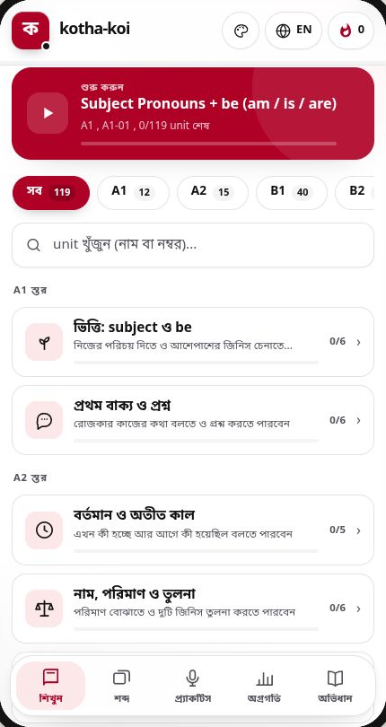
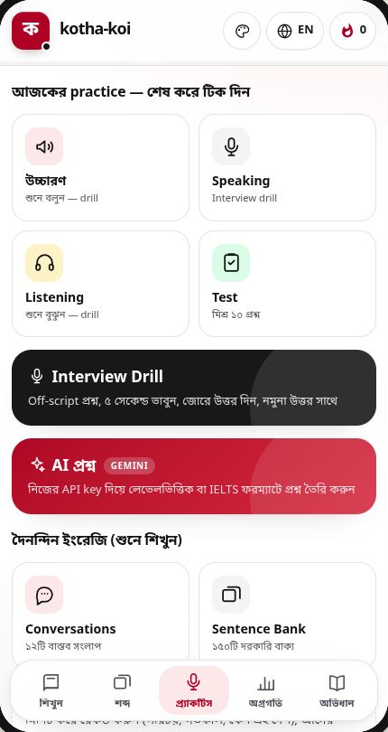
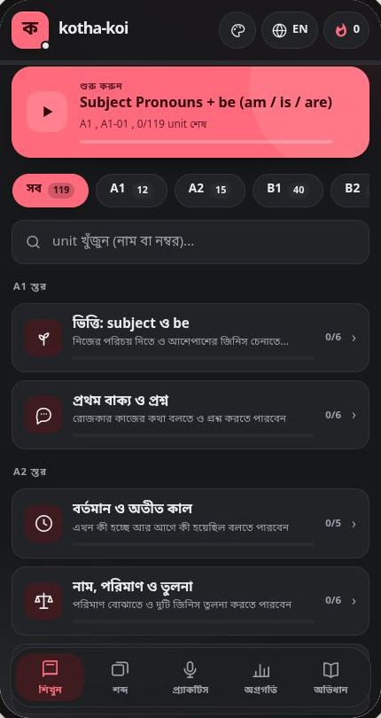
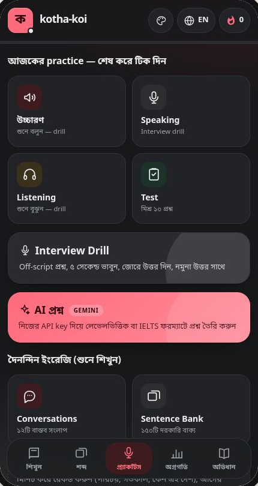

# kotha-koi

**কথা বলো, রোজ বলো.** · *A little English, every day.*

kotha-koi is a free, offline English-learning app that takes you from absolute
beginner (A1) to advanced (C2) and IELTS 7.5+. It ships with **119 units**,
**1,428 practice questions**, an interview drill with model answers, listening
practice, a **103,646-word English–Bangla dictionary**, a **5,524-word CEFR +
IELTS word bank**, and a calm Material interface with eight hand-picked colour
themes and a floating dock — all working without an internet connection.

> Independent self-study tool. Not affiliated with any exam board, language
> institute, embassy, or government program.

---

## Screenshots

<table>
  <tr>
    <td align="center"><br><sub>Home · light</sub></td>
    <td align="center"><br><sub>Practice · light</sub></td>
  </tr>
  <tr>
    <td align="center"><br><sub>Home · dark</sub></td>
    <td align="center"><br><sub>Practice · dark</sub></td>
  </tr>
</table>

Light and dark appearance both work with every colour theme — switch them any
time from the palette button in the top bar.

## What's inside

| Feature | Description |
|---|---|
| **Fully offline** | Lessons, questions and progress live on your device. No account, no server. |
| **A1 → C2 path** | A complete CEFR-aligned journey across 119 units and 23 chapters. |
| **1,428 practice questions** | A large question bank with explanations and retry attempts. |
| **Interview drill** | Practice common interview questions with model answers. |
| **Irregular verbs** | Searchable reference of 204 irregular verbs with base, past and past participle forms, Bangla meanings from the word bank, and tap-to-listen. |
| **AI questions (optional)** | Bring your own Gemini API key to generate level-based (A1–C2) MCQs, IELTS-format Speaking, Writing and Reading practice with model answers, plus fresh sentences and conversations on any Sentence Bank topic. Generated sets are saved on the device and reopen offline. |
| **Listening & pronunciation** | Platform text-to-speech plus focused pronunciation drills. |
| **Offline dictionary** | 103,646 English words with Bangla meanings, instant search, word of the day and recent lookups. |
| **CEFR → IELTS word bank** | 4,954 Oxford 3000/5000 words (A1–C1), the 570-word Academic Word List and 2,632 phrases — with multiple senses, English glosses, learned ticks, progress and 10-word flashcard sessions. |
| **Progress & streaks** | Daily ticks, scores, completion and a 14-day view. |
| **Eight themes** | Vermilion, Paper, Night, Cobalt, Sepia, Bagan, Rose and Ink — each with a light and a dark look, plus Auto mode. |
| **No account needed** | Open the app and start. |

> The only optional online feature is AI question generation. It runs only when
> you tap **Generate** and uses your own Gemini API key; lessons, dictionary,
> word bank and progress never need a connection. Anything the AI generates is
> saved on your device and can be reopened later without the internet.

### Themes

| Theme | Mood |
|---|---|
| **Vermilion** | The default: pure white, near-black and a deep editorial red. |
| **Paper** | Warm oat paper, deep green ink and terracotta. |
| **Night** | Warm charcoal with mint and amber. |
| **Cobalt** | Cool white, clear blue and a teal accent. |
| **Sepia** | Old book pages, brown ink, quiet green. |
| **Bagan** | Soft sage and forest green. |
| **Rose** | Soft blush, deep burgundy and warm clay. |
| **Ink** | High-contrast warm white, black and vermilion. |
| **Auto** | Default accent; follows your device's light/dark setting. |

Open the palette button in the top bar (or **Progress → About**) to pick a
colour theme and set **Appearance** to Auto, Light or Dark. Appearance is
independent of the colour theme, so every theme has both a light and a dark
version.

---

## Platforms

kotha-koi runs on **Android**, **Windows**, **Linux**, and the **web**.

- All builds are ad-free: no ad SDK, banners, interstitials, or rewarded videos.

Download the latest build from
[**Releases**](../../releases/latest).

### Android (sideload APK)

1. Download `kotha-koi-<version>.apk` from the latest release.
2. Open the file and allow **Install unknown apps** for your browser or file
   manager when Android asks.
3. Tap **Install**, then open **kotha-koi**.

### Windows

Download `kotha-koi_<version>_x64-setup.exe` from the latest release and run it.
If SmartScreen appears for an unsigned build, choose **More info → Run anyway**
only if you trust the download.

### Linux

Download the `.AppImage` or `.deb` from the latest release.

```bash
chmod +x kotha-koi_<version>_amd64.AppImage
./kotha-koi_<version>_amd64.AppImage

# or
sudo dpkg -i kotha-koi_<version>_amd64.deb
```

### Web

Download `kotha-koi-web-<version>.zip`, unzip it, and open `index.html` in a
modern browser. The web build can also be served from any static host.

---

## Build from source

Requirements:

- **Android:** JDK 17 and the Android SDK (platform 35, build-tools 35.0.0)
- **Desktop:** Rust stable + the Tauri prerequisites for your OS
- **Web:** no build step — plain HTML, CSS and JavaScript

The UI is shared by all three targets. After editing `web/`, sync the copies:

```bash
python scripts/sync-web.py
```

### Android

```bash
cd android
./gradlew assembleRelease
# APK: app/build/outputs/apk/release/app-release.apk
```

### Desktop

```bash
cd desktop
cargo tauri build
```

### Run the web version locally

```bash
cd web
python3 -m http.server 8080
# open http://localhost:8080
```

---

## Automatic releases

`.github/workflows/release.yml` builds and publishes the app whenever you push
to `main`/`master`, push a tag like `v1.2.0`, or run the workflow manually.

Each run:

1. Creates a GitHub release.
2. Builds a release APK and attaches it as `kotha-koi-<version>.apk`.
3. Builds Windows and Linux desktop bundles with Tauri.
4. Zips the static web app and attaches it.
5. Adds generated release notes.

Push to a branch → version `1.0.<run-number>`. Push a tag → that tag's version.

### Android signing

The repository includes a release keystore at
`android/kotha-koi-release.keystore` with its passwords in
`android/release-signing.properties`, so every build from CI is signed and can
update an earlier install.

> **Warning:** this key is public — anyone with the repository can sign an APK
> that Android will accept as an update to kotha-koi. That is fine for a free
> sideloaded app, but **never use this key for Google Play**: Play requires a
> private upload key, and a leaked key cannot be rotated for existing installs.
> If you fork this project for real distribution, generate your own key and
> keep it out of the repository.

To override the committed key, add these repository secrets (the workflow
writes them to the gitignored `android/keystore.properties`, which takes
priority over the committed key):

| Secret | Value |
|---|---|
| `ANDROID_KEYSTORE_BASE64` | `base64 -w0 release.keystore` |
| `ANDROID_KEYSTORE_PASSWORD` | keystore password |
| `ANDROID_KEY_ALIAS` | key alias |
| `ANDROID_KEY_PASSWORD` | key password |

Committed key fingerprint (SHA-256):
`7C:50:87:F3:49:61:6D:27:21:D9:CE:9C:13:27:2B:15:B6:5B:55:15:CA:22:F4:5D:21:97:CB:5B:0C:43:6D:DA`

Create a private keystore the same way:

```bash
keytool -genkeypair -v -keystore release.keystore -alias kothakoi \
  -keyalg RSA -keysize 2048 -validity 10000
base64 -w0 release.keystore
```

Android needs the same key for every update, so back it up if you rotate. If you
installed an older build signed with a different key, uninstall it once before
installing the new APK.

---

## Tech

- **Android:** WebView shell (Kotlin) with native text-to-speech.
- **Desktop:** Tauri 2 wrapping the same web UI.
- **Web:** a single static HTML/CSS/JS app; lessons in `data.js`, the dictionary
  in `dict.js`, and the word bank in `vocab.js` (both loaded only when their tab
  opens).
- **Storage:** `localStorage` on the device — no server, accounts, or cloud sync.
- **Listening:** the platform's text-to-speech engine.

The dictionary is rebuilt from its upstream dataset, and the word bank is
compiled from the editable `data/word-bank-v3.json` (multi-sense entries with
Bengali and English glosses):

```bash
python scripts/build-dict.py                 # writes web/dict.js
python scripts/build-vocab.py                # writes web/vocab.js from data/word-bank-v3.json
python scripts/build-vocab.py --legacy       # old upstream Oxford/AWL rebuild
python scripts/sync-web.py                   # copies all assets to Android + desktop
```

---

## Licenses

kotha-koi uses a split license:

- **Application code** is open source under the **MIT License** — see
  [`LICENSE-CODE`](LICENSE-CODE).
- **Learning content** (lesson text, practice questions, explanations and model
  answers) is **All Rights Reserved** — see [`CONTENT-LICENSE.md`](CONTENT-LICENSE.md).
  You may study with it inside the app; redistribution or resale is not allowed.
- **Dictionary data** comes from
  [MinhasKamal/BengaliDictionary](https://github.com/MinhasKamal/BengaliDictionary)
  (JSON prepared by
  [Nafisa41](https://github.com/Nafisa41/Dictionary--English-to-Bangla-)) and is
  distributed under **GPL-3.0** — see [`DICTIONARY-LICENSE`](DICTIONARY-LICENSE).
- **Word-bank data** combines the Oxford 3000/5000 and phrase lists (via
  [nalgeon/words](https://github.com/nalgeon/words)), the AWL 570, and Bangla
  glosses from Nafisa41 plus
  [zakariahossen](https://github.com/zakariahossen/English-Bangla-Dictionary).
  See [`VOCAB-LICENSE.md`](VOCAB-LICENSE.md) for each source and its terms.

## Privacy

kotha-koi collects no personal information itself and has no user accounts.
All builds are ad-free. The only optional network feature is AI question
generation, which uses a Gemini API key you supply and store locally.
See [`PRIVACY_POLICY.md`](PRIVACY_POLICY.md).

---

## Author

Built by **MD Fahad Alam**.

- GitHub: [github.com/SHADw9](https://github.com/SHADw9)
- Instagram: [@mdfahadalam9](https://instagram.com/mdfahadalam9)

---

## Disclaimer

kotha-koi is an independent self-study tool. It is **not affiliated with,
endorsed by, or connected to** any examination board, official language-testing
organization, embassy, ministry, or government program. Studying with this app
does not guarantee any test score, certification, visa, or migration outcome.
